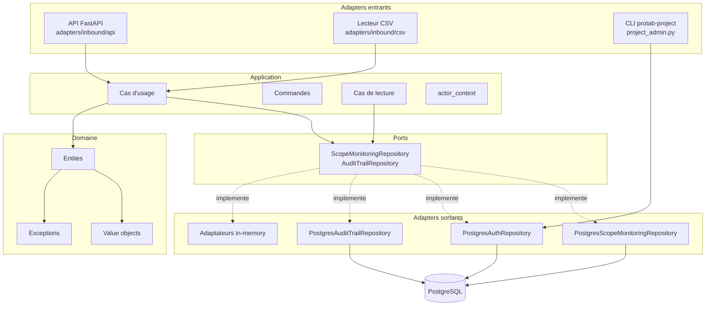
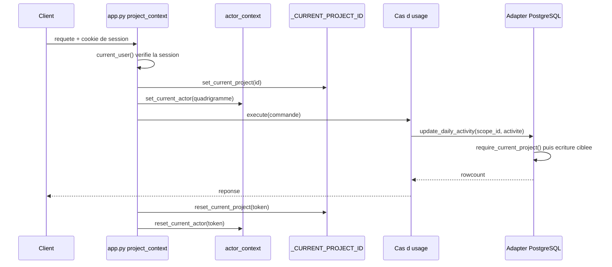
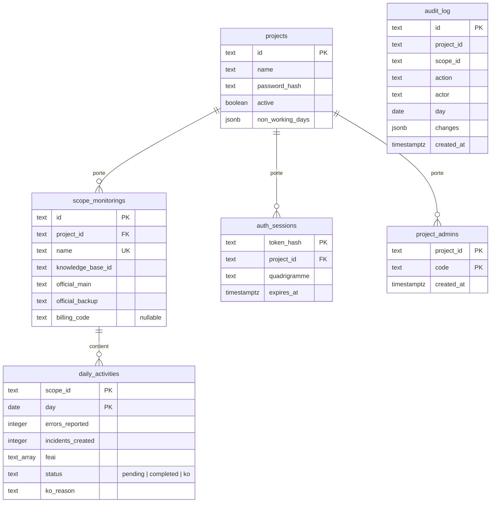

# Architecture

> **Documentation humaine, non normative.** Ce document facilite la maintenance.
> En cas de divergence, **le code et `AGENTS.md` font foi**. Aucune règle ne doit
> être appliquée sur la seule foi de ce document. Les invariants qui *doivent*
> être respectés sont énoncés dans `AGENTS.md` (en particulier §2, §4, §11 et
> §28) ; ici on se contente de décrire ce qui existe et où.

Ce document décrit la structure interne de ProTab : les couches, le modèle de
données, le cycle d'une requête et les points où le code peut dériver de la
plaine. Pour l'installation et les commandes, voir
[`docs/development.md`](development.md) ; pour la topologie des conteneurs, voir
[`docs/docker-architecture.md`](docker-architecture.md).

---

## 1. Ce que fait l'application

ProTab sert un seul métier : **le suivi quotidien d'incidents par périmètre de
surveillance**, en multi-tenant, avec traçabilité des écritures.

Deux notions suffisent à comprendre le domaine :

- **un périmètre** (`ScopeMonitoring`) — un ensemble nommé, rattaché à une base
  de connaissances et à des agents ;
- **une activité journalière** (`DailyActivity`) — pour un périmètre et un jour
  donnés, le nombre d'erreurs signalées, le nombre d'incidents ouverts et la
  liste des références FEAI.

Autour de cela, deux annexes transverses : une **authentification par
quadrigramme** (projet + mot de passe partagé, session en cookie) et un
**journal d'audit** des modifications.

---

## 2. Vue d'ensemble des couches

Le projet applique une architecture hexagonale. Les dépendances pointent vers
le cœur : les adaptateurs dépendent des ports, les ports ne dépendent que du
domaine, et le domaine ne dépend de rien.

Trois remarques utiles à un mainteneur :

1. **`src/protab/ports/inbound/` est vide.** Aucun port entrant n'est déclaré :
   l'API appelle directement les classes de cas d'usage. C'est un écart
   assumé par rapport à la structure recommandée en `AGENTS.md` §7.1, sans
   conséquence pratique tant que l'API reste le seul adaptateur entrant du
   cœur.
2. **Les adaptateurs mémoire vivent dans `adapters/outbound/persistence/`**
   (`in_memory_scope_monitoring_repository.py`,
   `in_memory_audit_trail_repository.py`), aux côtés des adaptateurs PostgreSQL,
   et non dans un paquet `memory/` distinct. `InMemoryScopeMonitoringRepository`
   ne sert qu'à l'injection explicite par les tests.
3. **L'adaptateur d'audit n'est pas dans le port de périmètre.** Le journal
   d'audit a son propre port
   (`ports/outbound/audit_trail_repository.py`) : les cas d'usage reçoivent deux
   dépendances (`repository` et `audit_trail`, ce dernier optionnel — cf. §5).

---

## 3. Le domaine

`src/protab/domain/` ne contient ni FastAPI, ni `psycopg`, ni le moindre nom de
table SQL. C'est la partie la plus facile à tester et la moins volatile.

| Élément | Fichier | Rôle |
| --- | --- | --- |
| `ScopeMonitoring`, `Officials`, `KnowledgeBase` | `entities/scope_monitoring.py` | Agrégat racine d'un périmètre ; `daily_activity_for(day)` sert de point d'accès à un jour |
| `DailyActivity` | `entities/daily_activity.py` | Valeurs d'une journée, mutable, avec `update()` (compteurs) et `apply_status()` (statut) — deux propriétaires distincts |
| `DayStatus` | `entities/day_status.py` | Les trois états d'une journée (`pending`, `completed`, `ko`) ; `from_raw()` relit la colonne `TEXT` de façon lenient, `KO_REASON_MAX_LENGTH` y est déclaré |
| `AuditEvent`, `build_changes()` | `entities/audit_event.py` | Événement immuable ; `build_changes` ne retient que les champs réellement modifiés |
| `OfficialCode` | `value_objects/official_code.py` | Forme scalaire d'un quadrigramme administrateur (2–20 caractères, refuse `/`) |
| `NonWorkingDays`, `IsoWeekday` | `value_objects/non_working_days.py` | Calendrier ouvré d'un projet ; l'échelle ISO (1 = lundi) et le défaut « week-end exclu » y sont déclarés, `from_raw()` reconstruit la colonne JSONB de façon lenient |
| Exceptions métier | `exceptions/` | `DomainError` et ses spécialisations, toutes traduites en codes HTTP par `adapters/inbound/api/errors.py` |

`domain/repositories/` et `domain/services/` ne contiennent qu'un
`__init__.py` : les contrats vivent dans `ports/`, et aucun service de domaine
n'a été nécessaire pour l'heure.

---

## 4. Les ports

### Port de périmètre — `ports/outbound/scope_monitoring_repository.py`

`Protocol` synchrone de neuf méthodes :

- `save(scope)` — **création seule**, refuse un id déjà pris ;
- `insert_daily_activity`, `update_daily_activity` — écritures ciblées des
  compteurs d'une journée ;
- `set_activities_status(scope_id, days, status, *, ko_reason=None)` — écriture
  ciblée du statut d'un lot de jours. Seul upsert du dépôt : voir §8 ;
- `update_note(scope_id, note)` — écriture ciblée de la note du périmètre ;
- `find_by_id`, `find_by_name`, `find_all`, `find_all_scope_names` — lectures.

`set_activities_status` est aussi la seule méthode dont l'upsert est légitime :
la clause `ON CONFLICT DO UPDATE` n'y réécrit que `status` et `ko_reason` de
lignes nommées, donc elle ne fusionne jamais des compteurs qu'un appelant n'a
pas relus — c'était précisément l'objection qui a retiré la clause de `save()`.
Un jour sans ligne est créé à compteurs nuls, ce qui rend le KO atteignable là
où il est utile : une journée que personne n'a pu traiter.

La distinction entre `save` et les écritures ciblées est une décision
d'architecture, pas un détail : ses raisons sont dans `AGENTS.md` §28.1.

Les deux adapters implémentent ce port, et `mypy` vérifie la compatibilité de
l'adapter PostgreSQL au point d'injection (`create_app(repository=...)`). Le
test de contrat
`tests/unit/ports/scope_monitoring_repository_contract_test.py` couvre les trois
implémentations — les deux adapters et le décorateur d'enregistrement des tests —
par réflexion, puisque `mypy` ne voit pas le code de test.

### Port d'audit — `ports/outbound/audit_trail_repository.py`

Deux méthodes : `record(event)` et une requête de consultation acceptant un
`AuditEventQuery` dont le champ `limit` vaut **200 par défaut**.

Trois décisions de ce query object portent le comportement du filtre, et les
**deux adaptateurs doivent les respecter à l'identique** (§11) :

- `scope_ids` est un tuple : la liste vide ne filtre pas, un élément suffit.
  La saisie d'un UUID n'est plus exigée, le sélecteur de périmètres passe par
  les noms.
- `actor` est un **préfixe insensible à la casse**, pas une égalité. La colonne
  stocke `quadrigramme.strip().upper()`, donc une égalité renvoyait zéro ligne
  pour `abcd` comme pour le partiel `AB` — un filtre qui vide la table à la
  frappe se lit comme un filtre cassé.
- La période filtre **`created_at`**, pas `day`. `day` est la journée métier
  concernée et vaut `NULL` pour `scope_created`, `scope_imported` et
  `scope_note_updated` : la filtrer faisait disparaître un tiers du journal dès
  qu'une date était saisie. La fenêtre est **semi-ouverte**
  (`from` inclusif, `to` exclusif), seule façon d-dire « toute cette journée »
  sans arrondi à la seconde près ; le serveur n'ayant aucun fuseau, le front
  résout les minuits locaux en instants avant d'appeler.

La normalisation de `actor` (`.strip().upper()`, blanc = aucun filtre) est faite
**une seule fois à la frontière entrante** (`app.py`), jamais dans les adaptateurs.

### Absence de port pour l'authentification

`PostgresAuthRepository` n'est **pas** derrière un `Protocol` : l'API et la CLI
l'utilisent directement. C'est cohérent avec le fait que l'authentification est
une préoccupation d'infrastructure, mais cela lie l'adaptateur entrant
(`app.py`, `auth.py`) au module `psycopg` — voir §8.

Ce lien reste réel, donc aucune **règle** ne doit y être importée depuis
l'adapter : les bornes ISO de `NonWorkingDaysRequest` viennent du value object du
domaine, comme la durée de session (`SESSION_DURATION`), dont le cookie dérive son
`Max-Age` au lieu de la redéclarer.

---

## 5. La couche application

`src/protab/application/` orchestre, sans jamais toucher à la base.

- **Cas d'usage** (`use_cases/`) : `CreateScopeMonitoring`,
  `CreateDailyActivity`, `UpdateDailyActivity`, `SetActivitiesStatus`,
  `UpdateScopeNote`. Chacun prend ses ports par constructeur et un
  `audit_trail` optionnel ; aucun ne construit de connexion.
- **Commandes** (`commands/`) : dataclasses d'entrée
  (`create_scope_monitoring.py`, `daily_activity.py`).
- **Requêtes** (`queries/`) : `ListScopes`, `GetScope`, `GetDailyActivity`,
  `ListAuditEvents` — lectures seules, aucun effet de bord.
- **Contexte d'acteur** (`actor_context.py`) : un `ContextVar`
  `_CURRENT_ACTOR` posé et remis par l'API, lu par les cas d'usage via
  `current_actor()`. Il permet d'attribuer un quadrigramme à un événement
  d'audit **sans que le cas d'usage connaisse FastAPI ni la session HTTP**.

Deux comportements méritent d'être connus avant de modifier un cas d'usage :

- `SetActivitiesStatusUseCase` résout **tous** les jours avant d'en muter aucun
  (`set_activities_status.py`) : la commande est tout ou rien. Il porte aussi la
  seule règle d'asymétrie du dépôt — **une journée peut être signalée KO sans
  saisie, mais pas être terminée sans**. Le KO crée donc le jour à compteurs
  nuls ; `completed` sur un jour absent lève `DailyActivityNotFoundError`. Cette
  règle est ici et pas dans l'adapter parce que `rowcount` ne distingue plus un
  jour absent d'un jour mis à jour.
- `UpdateDailyActivityUseCase` n'écrit un événement d'audit que si
  `build_changes` est non vide : un `PATCH` sans changement réel ne pollue pas
  le journal.
- `UpdateScopeNoteUseCase` suit la même règle, avec une comparaison directe :
  réenregistrer une note identique n'ajoute aucun événement. Il compare la note
  **avant et après** `set_note()`, jamais la commande reçue, car le domaine
  normalise (une note blanche devient `None`).

---

## 6. Les adaptateurs entrants

### API — `adapters/inbound/api/`

`app.py:155-195` est le **composition root** : `create_app()` construit les
adaptateurs, les cas d'usage, l'instance `FastAPI` et le gestionnaire
d'arrêt. `create_default_app()` (`app.py:453-455`) est le point d'entrée du
processus.

Table des routes :

| Méthode | Chemin | `project_context` | Rôle |
| --- | --- | --- | --- |
| GET | `/healthz` | non | Sonde de disponibilité |
| GET | `/projects` | non | Liste les projets (écran de connexion) |
| POST | `/auth/login` | non | Ouvre une session, pose le cookie |
| GET | `/auth/me` | non * | Session courante — **401** si le cookie est absent |
| POST | `/auth/logout` | non * | Supprime la session et le cookie |
| GET / PUT | `/project/settings` | oui | Jours non ouvrés |
| GET | `/scope-monitorings` | oui | Liste les périmètres du projet |
| POST | `/scope-monitorings` | oui | Création (unitaire ou en lot) |
| POST | `/scope-monitorings/import-csv` | oui | Import CSV |
| GET | `/scope-monitorings/{scope_id}` | oui | Détail d'un périmètre |
| PATCH | `/scope-monitorings/{scope_id}` | oui | Note libre — **seule** route qui modifie un périmètre |
| GET | `/scope-monitorings/{scope_id}/activities/{day}` | oui | Compteurs d'un jour |
| POST | `/scope-monitorings/{scope_id}/activities` | oui | Création d'une activité |
| PATCH | `/scope-monitorings/{scope_id}/activities/{day}` | oui | Mise à jour des compteurs |
| PATCH | `/scope-monitorings/{scope_id}/activities/status` | oui | Statut d'un lot de jours (`completed`, `ko`, `pending`) |
| GET | `/api/audit-log` | oui | Journal d'audit |

\* `/auth/me` et `/auth/logout` figurent dans `PUBLIC_ROUTES` **parce qu'ils
gèrent eux-mêmes l'absence de session** (`current_user` lève un 401,
`auth.py:21-38`) : y poser la dépendance renverrait la même erreur, mais par un
chemin différent — et pour `logout`, un utilisateur sans session doit pouvoir
nettoyer son cookie. Ce ne sont donc pas des routes ouvertes.

Il n'existe **aucune route de suppression de périmètre** ni de mise à jour :
`POST /scope-monitorings` ne fait que créer, et le nom est `UNIQUE` globalement.

Deux points d'attention :

- **La colonne « non » n'est pas décorative.** L'authentification est appliquée
  par la dépendance `project_context` (`app.py:208-219`), et non par une
  vérification dans chaque handler. Une route qui oublie
  `dependencies=[Depends(project_context)]` est donc réellement publique.
  `tests/integration/adapters/route_authorization_test.py` inverse la
  polarité du contrôle pour attraper ce cas.
- **La traduction des erreurs est centralisée** dans
  `adapters/inbound/api/errors.py:16-42` : 404 pour « introuvable », 409 pour
  « déjà existant », 400 pour les autres `DomainError`, 500 avec un message
  générique pour le reste. C'est le seul endroit où une exception du domaine
  devient un code HTTP.

### CSV — `adapters/inbound/csv/scope_monitoring_csv_reader.py`

`parse_scope_monitorings_csv()` transforme un contenu de fichier en liste de
commandes, et lève `ScopeMonitoringCsvError` (→ 400). L'import passe par le
même cas d'usage que la création manuelle ; seule la source de l'événement
d'audit change (`scope_imported` au lieu de `scope_created`,
`create_scope_monitoring.py:48`).

### CLI — `src/protab/project_admin.py`

Administration **d'hôte** : création de projet, rotation de mot de passe,
gestion des administrateurs de projet. Elle vit à la racine du paquet, et non
dans `adapters/inbound/cli/` (paquet vide). Les sous-commandes sont résolues
avant `argparse` (`project_admin.py:234-258`) pour que `protab-project --help`
liste tout l'inventaire ; la forme historique `protab-project <code> <nom>`
reste acceptée. Le mot de passe est toujours lu par `getpass`, jamais passé en
argument. La référence complète est [`docs/cli.md`](cli.md).

---

## 7. Les adaptateurs sortants

Tous vivent sous `adapters/outbound/persistence/` et utilisent `psycopg` en
mode **synchrone**, avec un pool partagé construit par `postgres_pool.py`.

- `PostgresScopeMonitoringRepository` — schéma de `projects`,
  `scope_monitorings` et `daily_activities`. `scope_monitorings.note` est
  `TEXT` nullable, ajoutée par `ALTER TABLE ... ADD COLUMN IF NOT EXISTS` au
  démarrage, comme `billing_code`.
- `PostgresAuthRepository` — `projects`, `auth_sessions`, `project_admins`
  (`postgres_auth_repository.py`), plus l'amorçage du projet initial. Il ne
  valide plus les jours non travaillés : il persiste `NonWorkingDays.to_dict()`
  et relit par `NonWorkingDays.from_raw()`.
- `PostgresAuditTrailRepository` — table `audit_log`
  (`postgres_audit_trail_repository.py:25`). Le filtre `actor` est un `ILIKE`
  `'préfixe%'` ; il n'exploite donc **pas** `idx_audit_log_actor` (un btree ne
  peut pas servir un `ILIKE`), ce qui est acceptable à l'échelle d'un journal
  d'audit. `ILIKE` est préféré à un `LIKE` sur un terme pré-majusculé pour que
  l'insensibilité à la casse ne dépende pas de la façon dont la colonne est
  stockée aujourd'hui.

**Il n'y a pas d'outil de migration.** Le schéma est appliqué de façon
idempotente à chaque `connect()`, par `CREATE TABLE IF NOT EXISTS` et quelques
`ALTER TABLE ... ADD COLUMN IF NOT EXISTS`
(`postgres_scope_monitoring_repository.py:164-193`). Une installation existante
doit donc être mise à niveau par ces instructions, et toute réparation manuelle
doit rester compatible avec elles. Les raisons sont en `AGENTS.md` §28.1.

Les violations de contraintes SQL sont traduites ici, à la frontière, en
exceptions du domaine (`_translate_unique_violation`,
`postgres_scope_monitoring_repository.py:308`). C'est le seul point où une
`IntegrityError` devient une `ScopeMonitoringNameAlreadyExistsError` ou une
`DuplicateDailyActivityError`.

---

## 8. Multi-tenant : le mécanisme à comprendre avant toute modification

Le projet courant ne transite **jamais** par les cas d'usage ni par les
entités. Il est porté par un `ContextVar` posé par l'adaptateur HTTP et lu par
les adaptateurs PostgreSQL :

Le bloc `finally` de `project_context` (`app.py:215-219`) garantit que les deux
remises ont lieu **même si le cas d'usage lève**. C'est ce qui empêche un
contexte projet de fuir d'une requête à l'autre.

Les conséquences pratiques, toutes documentées dans `AGENTS.md` §28.1 :

- `require_current_project()` (`postgres_scope_monitoring_repository.py:98-111`)
  lève `MissingProjectContextError` s'il n'y a pas de contexte : il n'existe
  **aucun repli** sur un projet par défaut.
- Toute requête SQL d'un adaptateur doit filtrer sur `project_id` sans
  condition. Une requête correcte dans un test à contexte unique peut fuiter
  entre tenants : le test d'un tenant isolé n'est pas une preuve suffisante.
- `daily_activities` **n'a pas de `project_id`** ; les écritures ciblées
  rejoignent `scope_monitorings` pour filtrer.

---

## 9. Modèle de données

Trois détails qui prêtent à erreur :

- `scope_monitorings.name` est **`UNIQUE` globalement**, pas par projet. Deux
  projets ne peuvent donc pas utiliser le même nom de périmètre.
- `official_main` et `official_backup` stockent une **liste** de
  quadrigrammes séparés par `/` (parseur commun :
  `postgres_auth_repository.py:130-146`), pas un scalaire.
- `billing_code` est **obligatoire à la création mais nullable en base**. Les
  deux règles ne se contredisent pas : l'obligation vit dans le domaine
  (`ScopeMonitoring.create()`) et dans le schéma Pydantic, jamais dans la
  colonne. Un `NOT NULL` ferait échouer l'`ALTER TABLE ... ADD COLUMN IF NOT
  EXISTS` du démarrage sur une table déjà peuplée, et le constructeur — chemin
  de réhydratation des repositories — refuse de lever sur une ligne lue : une
  seule ligne ancienne illisible viderait toute la liste. Aucune route ne
  permet de compléter un code manquant après coup, la reprise se fait en SQL
  (`docs/cli.md`).

---

## 10. Cycle de vie d'une écriture

En prenant pour exemple la mise à jour des compteurs d'une journée :

1. Le front envoie un `PATCH /scope-monitorings/{id}/activities/{day}`.
2. La dépendance `project_context` vérifie le cookie, résout le projet et pose
   les deux `ContextVar` (`app.py:208-219`).
3. Le schéma Pydantic de la requête valide et convertit en
   `UpdateDailyActivityCommand`.
4. `UpdateDailyActivityUseCase.execute` relit le périmètre, récupère l'activité
   du jour, **relit l'état précédent**, applique `activity.update(...)`.
5. Le cas d'usage appelle `repository.update_daily_activity(scope_id, activity)`
   — une écriture ciblée, qui ne touche que la ligne nommée.
6. Si le diff est non vide, un `AuditEvent` `activity_updated` est enregistré
   avec `actor = current_actor()`.
7. Les `ContextVar` sont remises dans le bloc `finally`, y compris en cas
   d'exception.
8. Les erreurs du domaine deviennent des codes HTTP dans `errors.py`.

---

## 11. Où aller quand…

| Question | Fichier à ouvrir |
| --- | --- |
| Une règle métier de périmètre ou de journée | `src/protab/domain/entities/` |
| Un code HTTP ou un message d'erreur | `src/protab/adapters/inbound/api/errors.py` |
| Une route, son authentification, son schéma | `src/protab/adapters/inbound/api/app.py`, `schemas.py` |
| Le comportement d'une écriture en base | `postgres_scope_monitoring_repository.py` |
| Le schéma SQL et son absence de migration | `_SCHEMA_STATEMENTS` et `_apply_schema` |
| La connexion, le mot de passe projet, les administrateurs | `postgres_auth_repository.py` |
| L'administration d'hôte | `project_admin.py`, puis [`docs/cli.md`](cli.md) |
| L'isolation multi-tenant | `require_current_project()` + `AGENTS.md` §28.1 |

---

## 12. Documents voisins

- [`docs/development.md`](development.md) — installation, commandes, variables,
  déplooiement.
- [`docs/testing.md`](testing.md) — stratégie, suites, tests à base de données.
- [`docs/frontend.md`](frontend.md) — architecture React, thème, accessibilité.
- [`docs/cli.md`](cli.md) — référence de la CLI `protab-project`.
- [`docs/docker-architecture.md`](docker-architecture.md) — topologie des
  conteneurs.
- `AGENTS.md` — règles normatives du dépôt.
