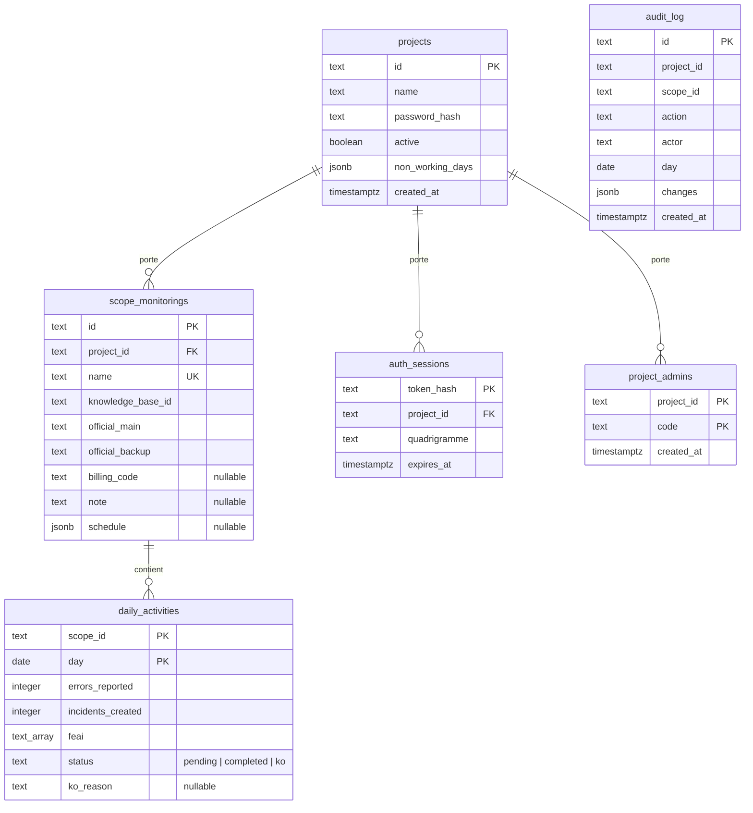

# Base de données

> **Documentation humaine, non normative.** En cas de divergence, le code et
> `AGENTS.md` font foi. Ce document décrit le schéma appliqué par
> `adapters/outbound/persistence/` et les règles de persistance qui en découlent.

PostgreSQL est la seule base supportée par l'API en production. L'accès passe par
`psycopg` en mode **synchrone**, derrière un pool partagé. Les adaptateurs mémoire
existent pour les tests, jamais pour l'exécution.

---

## 1. Modèle relationnel



`audit_log` n'a **aucune clé étrangère** : c'est un journal, il doit conserver un
événement même si le périmètre ou le projet qu'il mentionne a disparu. Ses
colonnes `project_id`, `scope_id` et `day` sont indicatives.

---

## 2. Tables et contraintes

### `projects`

| Colonne | Type | Contrainte |
| --- | --- | --- |
| `id` | `TEXT` | clé primaire |
| `name` | `TEXT` | `NOT NULL` |
| `password_hash` | `TEXT` | `NOT NULL`, format `scrypt$sel$empreinte` |
| `active` | `BOOLEAN` | `NOT NULL DEFAULT TRUE` |
| `non_working_days` | `JSONB` | nullable — `NULL` lit le calendrier par défaut |
| `created_at` | `TIMESTAMPTZ` | `NOT NULL DEFAULT NOW()` |

`active = FALSE` rend le projet invisible pour `get_project()` et
`list_projects()` : un projet inactif ne se connecte plus.

### `scope_monitorings`

| Colonne | Type | Contrainte |
| --- | --- | --- |
| `id` | `TEXT` | clé primaire |
| `project_id` | `TEXT` | FK `projects(id)` `ON DELETE CASCADE`, nullable en base |
| `name` | `TEXT` | `NOT NULL UNIQUE` — **globalement**, pas par projet |
| `knowledge_base_id` | `TEXT` | `NOT NULL` |
| `official_main` | `TEXT` | `NOT NULL`, liste séparée par `/` |
| `official_backup` | `TEXT` | `NOT NULL`, liste séparée par `/` |
| `billing_code` | `TEXT` | nullable |
| `note` | `TEXT` | nullable |
| `schedule` | `JSONB` | nullable — `NULL` vaut « tous les jours ouvrés » |

Index : `idx_scope_monitorings_project_name` sur `(project_id, name)`.

`project_id` est nullable uniquement pour permettre la migration de bases
antérieures : le démarrage renseigne `'protab'` sur les lignes nulles, puis
ajoute la contrainte de clé étrangère si elle manque. Toute réparation manuelle
doit donc restaurer un `project_id` valide avant de redémarrer.

### `daily_activities`

| Colonne | Type | Contrainte |
| --- | --- | --- |
| `scope_id` | `TEXT` | FK `scope_monitorings(id)` `ON DELETE CASCADE` |
| `day` | `DATE` | `NOT NULL` |
| `errors_reported` | `INTEGER` | `NOT NULL` |
| `incidents_created` | `INTEGER` | `NOT NULL` |
| `feai` | `TEXT[]` | `NOT NULL DEFAULT '{}'` |
| `status` | `TEXT` | `NOT NULL DEFAULT 'pending'`, **sans `CHECK`** |
| `ko_reason` | `TEXT` | nullable |

Clé primaire : `(scope_id, day)`. C'est elle qui garantit « une seule activité
par périmètre et par jour », en plus de l'invariant du domaine.

`daily_activities` **n'a pas de `project_id`**. La tenancy passe par
`scope_monitorings` : toute écriture ciblée joint la table parente et filtre
`s.project_id`. Une requête qui ne filtre pas le projet est un défaut, même si
la ligne visée existe.

Aucun `CHECK` sur `status` : un `ALTER TABLE ... ADD CONSTRAINT` bloquerait le
démarrage sur une ligne écrite à la main. La validation est portée par le domaine
et le schéma HTTP.

### `auth_sessions`

| Colonne | Type | Contrainte |
| --- | --- | --- |
| `token_hash` | `TEXT` | clé primaire — SHA-256 du jeton, jamais le jeton |
| `project_id` | `TEXT` | FK `projects(id)` `ON DELETE CASCADE` |
| `quadrigramme` | `TEXT` | `NOT NULL`, normalisé en majuscules |
| `expires_at` | `TIMESTAMPTZ` | `NOT NULL` |

Une session expirée n'est jamais supprimée par une tâche de fond : elle est
simplement ignorée par `find_session()`. La ligne disparaît à la déconnexion, à
la rotation du mot de passe ou à la révocation d'un administrateur.

### `project_admins`

| Colonne | Type | Contrainte |
| --- | --- | --- |
| `project_id` | `TEXT` | FK `projects(id)` `ON DELETE CASCADE` |
| `code` | `TEXT` | `NOT NULL` |
| `created_at` | `TIMESTAMPTZ` | `NOT NULL DEFAULT NOW()` |

Clé primaire : `(project_id, code)`. Une ligne par administrateur, et non une
colonne `TEXT` délimitée par `/` : l'identifiant est supprimé par nom, et
`created_at` doit rester possible par administrateur.

### `audit_log`

| Colonne | Type | Contrainte |
| --- | --- | --- |
| `id` | `TEXT` | clé primaire |
| `project_id` | `TEXT` | `NOT NULL`, sans FK |
| `actor` | `TEXT` | nullable |
| `action` | `TEXT` | `NOT NULL` |
| `scope_id` | `TEXT` | nullable, sans FK |
| `day` | `DATE` | nullable — journée métier, absente pour une création ou une note |
| `changes` | `JSONB` | `NOT NULL DEFAULT '{}'` |
| `created_at` | `TIMESTAMPTZ` | `NOT NULL DEFAULT NOW()` |

Index :

- `idx_audit_log_project_created` sur `(project_id, created_at DESC)` ;
- `idx_audit_log_scope` sur `(scope_id)` ;
- `idx_audit_log_actor` sur `(actor)`.

Le filtre acteur utilise `ILIKE 'préfixe%'`, qui **n'exploite pas** l'index btree
`idx_audit_log_actor`. C'est acceptable à l'échelle d'un journal ; l'alternative
aurait été un `LIKE` sur un terme pré-majusculé, qui ferait dépendre
l'insensibilité à la casse du format de stockage actuel.

---

## 3. Pas d'outil de migration

Le schéma est appliqué de façon **idempotente** à chaque `connect()` :

- `CREATE TABLE IF NOT EXISTS` pour les tables ;
- `ALTER TABLE ... ADD COLUMN IF NOT EXISTS` pour les colonnes ajoutées après
  coup (`project_id`, `billing_code`, `note`, `schedule`, `non_working_days`,
  `status`, `ko_reason`) ;
- un bloc `DO $$` gardé sur `pg_constraint` pour la clé étrangère
  `scope_monitorings.project_id`.

Aucun Alembic, aucun numéro de version. Une installation existante se met à
niveau au démarrage suivant.

### Conséquences pour une évolution

- **Ajouter une colonne** : instruction `ADD COLUMN IF NOT EXISTS`. Une colonne
  sans valeur par défaut reste `NULL` sur les lignes existantes. Ne pas la
  déclarer `NOT NULL` dans la même instruction : l'`ALTER` échouerait sur une
  table déjà peuplée.
- **Modifier une contrainte** : `IF NOT EXISTS` n'existe pas pour une contrainte
  sous cette forme, d'où le bloc `DO $$` qui interroge `pg_constraint`.
- **Réparer des données** : l'opération doit rester compatible avec ce que le
  code fera au démarrage. La reprise d'un `billing_code` manquant est décrite
  dans [`cli.md`](cli.md) §9.

### La migration du statut

`daily_activities.status` remplace deux booléens `handled` et `completed`. La
migration est un `ADD COLUMN IF NOT EXISTS`, un backfill
`UPDATE ... SET status = 'completed' WHERE completed AND status = 'pending'`,
puis un `DROP COLUMN`. Les trois étapes partagent un **même garde** sur
l'existence de `completed` : sans ce garde, le premier redémarrage réussirait et
le deuxième échouerait en lisant une colonne déjà supprimée.

La migration ne s'exécute donc qu'une fois, et reste sans effet ensuite.

---

## 4. Écritures ciblées

`save()` **crée uniquement**. L'insertion est en `ON CONFLICT (id) DO NOTHING` :
un `save()` sur un identifiant déjà pris lève `ScopeMonitoringAlreadyExistsError`
avant toute écriture, au lieu de fusionner avec l'existant.

Toutes les mutations d'un périmètre existant passent par une écriture ciblée :

| Méthode | Lignes touchées |
| --- | --- |
| `insert_daily_activity` | une nouvelle ligne `daily_activities` |
| `update_daily_activity` | compteurs d'une ligne nommée |
| `set_activities_status` | `status` et `ko_reason` d'un lot de lignes nommées |
| `update_note` | `note` du périmètre nommé |
| `update_officials` | `official_main` et `official_backup` du périmètre nommé |
| `update_schedule` | `schedule` du périmètre nommé |

Le motif est la concurrence : un agrégat relu avant l'édition d'un autre
utilisateur ne doit pas être réécrit en entier. Un `save()` fusionnant
réécrirait des journées ou une note qu'il n'a pas relues.

`set_activities_status` est le **seul upsert** du dépôt. Sa clause
`ON CONFLICT DO UPDATE` ne réécrit que `status` et `ko_reason`, jamais les
compteurs. Un jour absent est créé à compteurs nuls, ce qui rend le KO
atteignable là où il est utile : une journée que personne n'a pu traiter.

Conséquence : `rowcount` ne distingue plus un jour absent d'un jour mis à jour
(PostgreSQL compte un `UPDATE` même sans changement). Le refus de terminer un
jour inexistant vit donc dans `SetActivitiesStatusUseCase`, pas dans
l'adaptateur.

Un `rowcount == 0` sur une écriture ciblée est traduit en
`DailyActivityNotFoundError` ou `ScopeMonitoringNotFoundError`.

---

## 5. Traduction des erreurs SQL

Les violations de contrainte sont traduites à la frontière, une seule fois :

| Erreur PostgreSQL | Exception de domaine |
| --- | --- |
| `UniqueViolation` sur `scope_monitorings.name` | `ScopeMonitoringNameAlreadyExistsError` |
| `UniqueViolation` sur `daily_activities(scope_id, day)` | `DuplicateDailyActivityError` |
| identifiant de périmètre déjà pris | `ScopeMonitoringAlreadyExistsError` |

Aucune `IntegrityError` ne doit remonter jusqu'au cas d'usage. Le point de
traduction est `_translate_unique_violation()` dans
`postgres_scope_monitoring_repository.py`.

---

## 6. Filtrage par tenant

Le projet courant est lu par `require_current_project()`, qui lève
`MissingProjectContextError` si le `ContextVar` est absent. Il n'existe **aucun
repli** sur un projet par défaut.

Règles pour toute requête SQL :

- filtrer sur `project_id` sans condition ;
- pour `daily_activities`, joindre `scope_monitorings` et filtrer
  `s.project_id` ;
- pour un `INSERT` dans `daily_activities`, conditionner l'insertion à
  l'existence du périmètre dans le projet courant, sinon la clé étrangère
  accepterait un `scope_id` d'un autre tenant.

Une requête correcte dans un test à contexte unique peut fuiter entre tenants :
le test d'un tenant isolé n'est pas une preuve suffisante.

---

## 7. Colonnes nullables et relecture lenient

Trois colonnes ont été ajoutées après les premières données, et sont donc
nullables :

| Colonne | `NULL` signifie |
| --- | --- |
| `scope_monitorings.billing_code` | code jamais renseigné |
| `scope_monitorings.note` | pas de note |
| `scope_monitorings.schedule` | tous les jours ouvrés |

Les constructeurs et les `from_raw()` sont **lenients** : une ligne illisible ne
doit pas vider la liste des périmètres de l'instance. Une valeur inconnue de
`DayStatus` retombe sur `pending` ; une périodicité illisible retombe sur
« tous les jours ouvrés » ; un calendrier illisible retombe sur le défaut.

Le refus est réservé aux **écritures** : `set_note()`, `apply_status()`,
`NonWorkingDaysRequest`, `ScheduleRequest`. La lecture ne refuse jamais.

---

## 8. Connexions et pool

Les trois adaptateurs PostgreSQL partagent la configuration de
`postgres_pool.py` :

| Paramètre | Valeur |
| --- | --- |
| `min_size` | 2 |
| `max_size` | 10 |
| `timeout` | 30 s |
| `max_lifetime` | 1800 s |
| `max_idle` | 600 s |
| `connect_timeout` | 5 s |
| vérification | `SELECT 1` avant usage |

Chaque adaptateur ouvre son propre pool (`protab-scope`, `protab-auth`,
`protab-audit`). Le pool est construit fermé (`open=False`) puis ouvert par
`connect()`, qui applique aussi le schéma. `close()` libère les connexions, et
`create_app()` enregistre la fermeture au shutdown de l'application.

Le mode `autocommit=False` est explicite : chaque écriture est validée par un
`commit` sur la connexion du pool.

---

## 9. Tests et base de test

Les tests d'intégration PostgreSQL sont ignorés tant que
`PROTAB_TEST_DATABASE_URL` n'est pas défini. `make test-db` crée la base
`protab_test` si besoin, puis lance la suite complète.

```bash
make test-db
make db-shell     # psql sur la base de développement
```

La stratégie et les pièges de ces tests sont dans [`testing.md`](testing.md).

---

## 10. Documents voisins

- [`domain-model.md`](domain-model.md) — règles portées par les entités, avant
  toute contrainte SQL ;
- [`api.md`](api.md) — routes et codes d'erreur ;
- [`authentication.md`](authentication.md) — `projects`, `auth_sessions`,
  `project_admins` ;
- [`architecture.md`](architecture.md) — ports, adaptateurs et cycle d'écriture ;
- [`cli.md`](cli.md) — réparation d'un code de facturation, dépannage SQL ;
- `AGENTS.md` §28.1 — raisons des choix de persistance.
