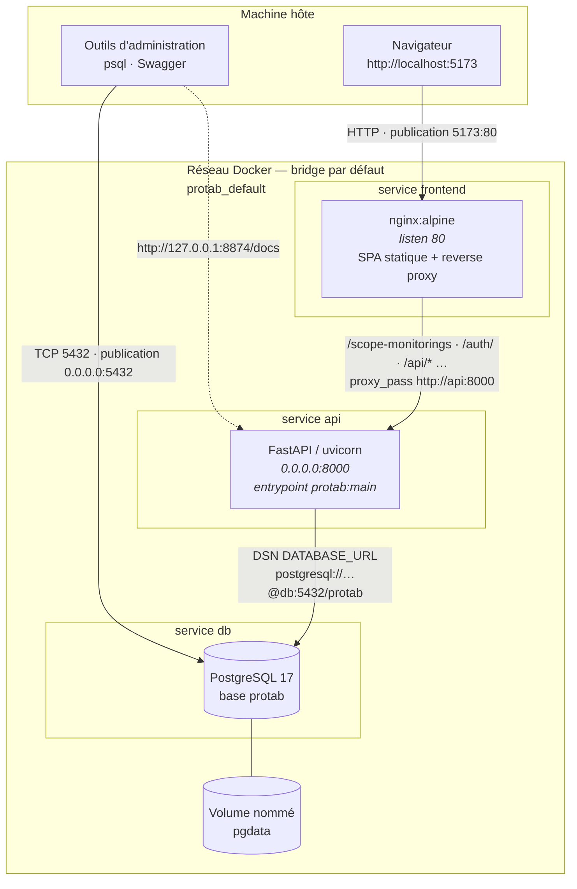
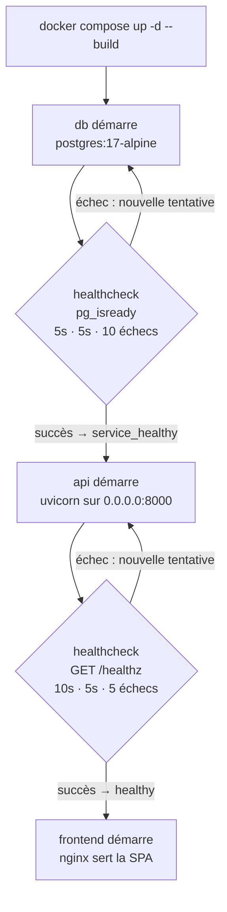
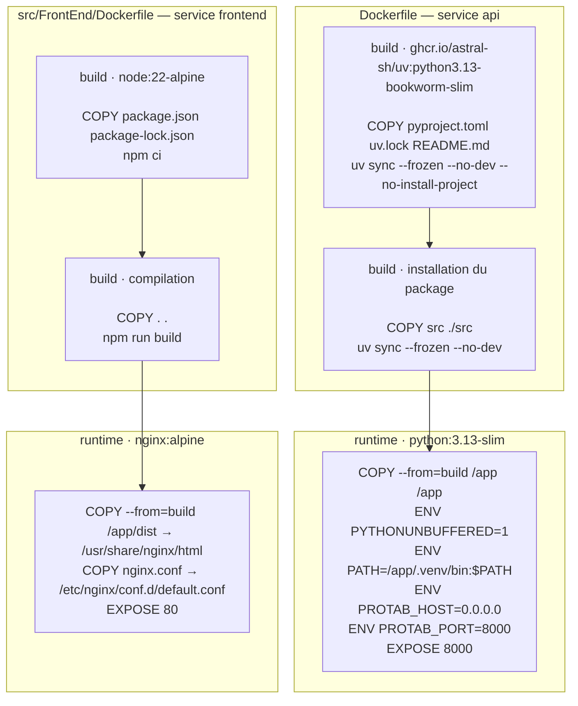
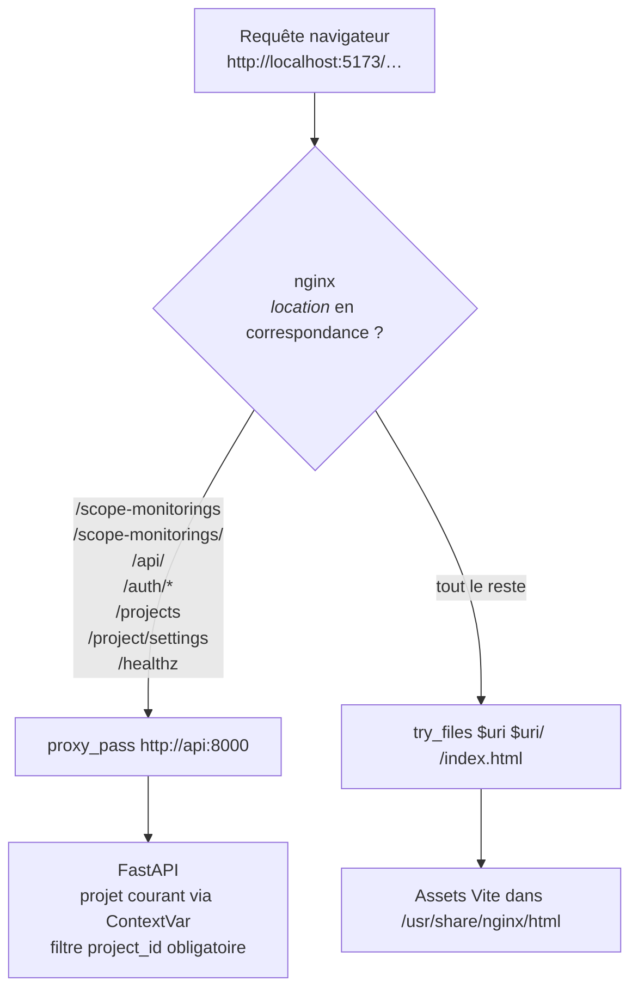

# L'architecture Docker de ProTab

La stack complète tient en trois services : une base PostgreSQL, une API FastAPI et un frontend servi par
nginx. Ce document décrit **comment ils sont assemblés, dans quel ordre ils démarrent, et ce qui est
visible depuis l'extérieur** — la source de vérité reste `docker-compose.yml`, les deux `Dockerfile` et
`src/FrontEnd/nginx.conf`.

Ce document est purement descriptif : il ne rejoue pas la configuration, il explique ce qu'elle produit.

---

## 1. Vue d'ensemble à l'exécution



### Ce que le diagramme dit du réseau

Il n'existe **aucun bloc `networks:`** dans `docker-compose.yml`. Les trois services partagent donc le
réseau bridge créé automatiquement par Compose, résolvable par le **nom du service** — c'est ce qui permet
à `api` de joindre `db:5432` dans son `DATABASE_URL`, sans publier ni découvrir d'IP.

Aucun volume n'est partagé entre services : le seul stockage persistant est celui de PostgreSQL, et
`api` est volontairement sans état (la session d'authentification est en base, pas en mémoire).

### Ce que le diagramme dit des ports publiés

Les trois publications n'ont **pas le même statut de sécurité**, et c'est délibéré :

| Publication           | Interface               | Raison                                                                                                                                                                                                                     |
| --------------------- | ----------------------- | -------------------------------------------------------------------------------------------------------------------------------------------------------------------------------------------------------------------------- |
| `5173:80`             | toutes les interfaces   | l'UI est le point d'entrée public, servie en HTTP                                                                                                                                                                          |
| `127.0.0.1:8874:8000` | **boucle locale seule** | l'API n'est pas destinée à être publiée : le cookie de session ne doit pas circuler en clair sur le réseau local. Le port `8874` est un décalage volontaire pour ne pas entrer en conflit avec un serveur de développement |
| `5432:5432`           | toutes les interfaces   | nécessaire pour `make db-shell` depuis l'hôte et pour un client SQL de développement                                                                                                                                       |

Conséquence à garder en tête : en production il faut **terminer TLS devant `frontend`**, puis passer
`PROTAB_COOKIE_SECURE=1` (§6). Et tant que `db` reste publié sur `0.0.0.0`, la base est joignable depuis
le réseau local — acceptable en développement, à revoir au moment du déploiement.

### Ports internes contre ports publiés

Le port **interne** d'un service n'a rien à voir avec le port publié. `frontend` écoute sur `80` et se
retrouve sur `5173` côté hôte ; `api` écoute sur `8000` et se retrouve sur `8874`. Les healthchecks
interrogent toujours le port **interne** — d'où `http://localhost:8000/healthz` dans le healthcheck de
`api`, et non `:8874`.

---

## 2. Ordre de démarrage : ce que les dépendances garantissent



`depends_on` est ici **conditionnel**, et c'est le cœur du mécanisme :

- `api` déclare `depends_on: db: condition: service_healthy`. Sans cela, l'API démarrerait pendant que
  PostgreSQL initialise encore son répertoire de données, échouerait sur la première connexion, et
  `restart: unless-stopped` la relancerait en boucle jusqu'à ce que la base soit prête par hasard.
- `frontend` déclare `depends_on: - api`, **sans condition** : il n'a rien à attendre de l'API. La SPA est
  un ensemble de fichiers statiques, elle sert l'index même quand l'API est indisponible — l'utilisateur
  voit alors l'écran de connexion, qui peut afficher proprement son erreur. Faire dépendre le serveur de
  fichiers de la disponibilité de l'application n'achèterait rien et retarderait le retour du service.

Les trois services déclarent `restart: unless-stopped` : ils reviennent après un redémarrage de la machine
ou un crash, sans intervention. Le point aveugle est le démarrage à froid après un `docker compose down`
sans volumes : `db` repart d'une base vide, et c'est alors le **premier** démarrage de `api` qui doit créer
le projet bootstrap (§4).

---

## 3. Chaîne de construction des images

Les deux images applicatives sont construites en **deux stages**, seul le second formant l'image finale.



### Pourquoi deux stages

Le premier stage ne sert qu'à **résoudre les dépendances** ; le second ne reçoit que le résultat, jamais
l'outillage. L'image `frontend` ne contient donc ni `node_modules`, ni les sources TypeScript : elle ne
transporte que le bundle Vite compilé et la config nginx, ce qui explique qu'elle tienne en 25 Mio sur
le disque.

L'image `api` est un cas différent, et la distinction mérite d'être posée : elle transporte bien
l'outillage de construction Python (`.venv` complet, 54 Mio), parce que `COPY --from=build /app /app`
recopie le répertoire `/app` en entier. C'est un choix assumé — l'API exécute directement ces
interpréteurs — mais il rend le `.dockerignore` racine critique : c'est lui qui empêche les sources
frontend d'entrer dans l'image.

**Un motif sans `/` initial ne correspond qu'à la racine du contexte.** `node_modules/` exclut
`./node_modules` mais laisse passer `./src/FrontEnd/node_modules` : le motif est évalué contre le
chemin relatif complet, or `src/FrontEnd/node_modules` ne commence pas par `node_modules`. Il faut
`**/node_modules/`.

C'est ce qui faisait entrer **220 Mio de dépendances JavaScript dans l'image de l'API**, qui
n'exécute aucun JavaScript. Le gain après correction : 420.7 → 188.8 Mio décompressés, 100.6 → 55.8 Mio
sur disque, sans toucher au `Dockerfile`. Le contexte de build passait de ~236 Mio à ~16 Mio, donc la
correction sert aussi au temps de build, pas seulement au poids livré.

Le motif `**/` est donc la règle dans les deux `.dockerignore`. `make resources` liste les répertoires
de développement présents dans les images en service, ce qui fait de la régression un défaut visible
plutôt qu'un chiffre que personne ne regarde. Mesures et dimensionnement : [`ressources.md`](ressources.md).

### Pourquoi le découplage des `COPY`

Sur l'API, les manifestes (`pyproject.toml`, `uv.lock`, `README.md`) sont copiés **avant** les sources.
`README.md` n'est pas décoratif : le backend de build `uv_build` l'exige comme métadonnée du package, et
l'étape échouerait sans lui. Tant que ces trois fichiers ne changent pas, la couche `uv sync` vient du
cache et seule une modification de `src/` déclenche une réinstallation.

Sur le frontend, c'est le découpage classique : `npm ci` sur les manifestes seuls, puis les sources. Comme
`package-lock.json` est versionné et que `node_modules` ne l'est pas, la résolution est reproductible.

### Un `.dockerignore` par contexte de build

Les deux images n'ont pas le même contexte — `api` part de la racine, `frontend` de `./src/FrontEnd` — donc
chacune a son `.dockerignore` :

- **racine** : exclut `.venv/`, `__pycache__/`, `node_modules/`, `dist/`, `.git/`, `.env` — tous
  préfixés par `**/`, pour la raison ci-dessus.
- **`src/FrontEnd/`** : exclut `node_modules`, `dist`, `.git`, `*.log`, `*.tsbuildinfo`. Le motif
  `**/` n'y est pas nécessaire, ce contexte n'ayant qu'un seul niveau — mais il est sans coût.

Ils ne sont pas redondants. Le contexte de `frontend` est `./src/FrontEnd`, et c'est **son** `.dockerignore`
qui filtre ce que `COPY . .` embarque : un artefact absent du `.gitignore` racine peut malgré tout entrer
dans l'image du frontend. Les fichiers de build TypeScript (`*.tsbuildinfo`, régénérés par `tsc -b` derrière
`npm run build`) sont le cas typique.

### Variables d'environnement

`api` est le seul service configuré. Elles arrivent par `environment:` dans Compose, qui les construit
depuis l'environnement d'exécution ou d'un `.env` :

| Variable                                          | Rôle                                                         |
| ------------------------------------------------- | ------------------------------------------------------------ |
| `DATABASE_URL`                                    | DSN complet, avec le nom de service `db` comme hôte          |
| `PROTAB_DEFAULT_PROJECT_CODE` / `_NAME`           | identité du projet créé au tout premier démarrage            |
| `PROTAB_DEFAULT_PROJECT_PASSWORD` / `_ADMIN_CODE` | secrets du projet bootstrap — voir §4                        |
| `PROTAB_COOKIE_SECURE`                            | attribut `Secure` du cookie de session, `0` en développement |

`PROTAB_HOST` et `PROTAB_PORT` ne sont pas dans Compose : ils sont **`ENV` du `Dockerfile`**. C'est
indispensable, car sans `0.0.0.0` le serveur n'écouterait que sur la boucle locale du conteneur et la
publication de port ne relaierait rien. Une variable fournie par Compose à l'exécution prend le dessus sur
l'`ENV` de l'image, mais rien ici ne neutralise l'écoute sur toutes les interfaces.

---

## 4. Le premier démarrage : une fenêtre, pas une configuration

Le projet bootstrap est créé **une seule fois**, quand la ligne du projet est absente de la base. Ce
n'est pas un détail d'implémentation, c'est la condition de redémarrabilité de l'installation :

- `PROTAB_DEFAULT_PROJECT_PASSWORD` et `PROTAB_DEFAULT_PROJECT_ADMIN_CODE` sont **fail-closed** : l'API
  refuse de démarrer (à la création du projet seulement) plutôt que de créer un projet avec un mot de passe
  devinable, ou un projet sans administrateur.
- Elles sont transmises **sans garde** dans `docker-compose.yml` (`${…:-}`), c'est-à-dire qu'une valeur
  vide est transmise telle quelle. C'est délibéré : exiger le secret à chaque `connect()` casserait le
  redémarrage de toute installation déjà initialisée, pour une valeur jamais utilisée. **L'application est
  le seul point d'application de la règle, Compose ne doit pas la rejouer** — c'est un contrat, pas un oubli.

Une fois le projet créé, ces variables ne sont plus lues : les supprimer du `.env` puis redémarrer est sans
effet. Le cycle complet est documenté dans [`.env.example`](../.env.example).

---

## 5. Requêtes : le rôle de nginx est plus qu'un serveur de fichiers



Le rôle de `frontend` est double : servir la SPA **et** être le point d'entrée unique de l'API. Le frontend
n'appelle donc jamais `api:8000` directement — tout passe par son propre origine, ce qui évite toute
configuration CORS et garde le cookie de session same-origin.

### Une route déclarée en exact **et** en préfixe

Sur les blocs `proxy_pass`, `/scope-monitorings` est dupliqué en version exacte (`= /chemin`) et en version
préfixe (`/chemin/`). Ce ne sont pas deux règles redondantes mais deux cas distincts : le frontend appelle
les routes **sans slash final** (`GET /scope-monitorings`), tandis que `location /scope-monitorings/` ne
correspondrait pas à cette URL exacte. L'API répond pourtant en `307` aux préfixés avec slash, vers leur
forme canonique — un client qui tomberait dessus serait redirigé, donc l'inexactitude serait invisible au
navigateur. Le couple `= /chemin` + `/chemin/` rend le proxy correct sans dépendre de cette redirection,
et `proxy_redirect off` laisse FastAPI gérer ses propres redirections sans double réécriture. `/api/` est
déclaré en préfixe seul, couvrant toutes les routes API déplacées sous ce préfixe.

Les autres ne sont déclarés qu'une seule fois, selon l'usage réel : `/projects`, `/healthz` et
`/project/settings` en **exact** (ce sont des routes sans sous-ressource), `/auth/` en **préfixe** (le
frontend appelle `/auth/login`, `/auth/logout`, etc.).

`/healthz` est lui aussi relayé : c'est ce qui rend la stack vérifiable depuis l'extérieur, sur le port
`5173`, sans avoir à toucher au port `8874` réservé à la boucle locale.

La liste des chemins relayés fait foi dans `nginx.conf` et se retrouve, côté application, dans la liste
d'authentification et les constantes de routage du front. **Ajouter une route API hors préfixe `/api/`
signifie ajouter son bloc `location` ici** — sinon la requête est servie par la SPA et l'appel échoue
en silence côté JavaScript. Les routes sous `/api/` sont déjà couvertes par le bloc préfixe unique.

### En-têtes transmis

Chaque bloc `proxy_pass` transmet `Host`, `X-Real-IP`, `X-Forwarded-For` et `X-Forwarded-Proto`. Les
journaux d'accès de l'API sont ainsi exploitables. `X-Forwarded-Proto` est posé à `$scheme`, c'est-à-dire
au schéma de la connexion **reçue par nginx** : si TLS est terminé en amont, l'en-tête d'origine est écrasé
par ce `$scheme`, et c'est une limite connue de la configuration actuelle — à corriger avant d'exposer la
stack derrière un terminateur TLS.

---

## 6. Sécurité : ce que la topologie garantit, et ce qu'elle ne garantit pas

**La topologie fait partie du modèle de sécurité.**

- Le cookie de session est `HttpOnly` + `SameSite=Lax`, et `Secure` n'est activé que si
  `PROTAB_COOKIE_SECURE` vaut `1`, `true`, `yes` ou `on`. Par défaut il est donc **absent**, puisque la
  stack de développement est en HTTP.
- L'isolation multi-tenant est portée par une `ContextVar` posée par la dépendance `project_context` : les
  adaptateurs PostgreSQL lèvent `MissingProjectContextError` si elle est absente, **sans repli sur un
  projet par défaut**. Toute requête SQL filtre sur `project_id` sans condition. C'est pourquoi l'API ne
  doit pas être exposée hors de la boucle locale sans TLS : une requête non authentifiée se voit refuser
  le projet, pas retomber sur quelqu'un d'autre.
- Une route oubliée de `project_context` fuiterait entre tenants.
  `tests/integration/adapters/route_authorization_test.py` inverse la polarité du test : seules les routes
  déclarées publiques peuvent l'être. Une nouvelle route publique doit y être ajoutée.
- `401` signifie session perdue, pas panne réseau. Le frontend le traite globalement et revient à l'écran
  de connexion — sauf sur `POST /auth/login`, où un `401` signifie mot de passe erroné et reste une erreur
  de formulaire.

**La topologie ne protège pas à elle seule.** Elle rend ces règles exprimables et vérifiables ; elle ne les
applique pas. TLS et le dimensionnement des publications restent une décision de déploiement.

---

## 7. Commandes de la stack

```bash
make docker-up        # docker compose up -d --build   → toute la stack
make docker-down      # docker compose down
make db-up            # uniquement db (développement hors container)
make db-shell         # psql dans le conteneur
make project-admin ARGS="add-admin protab MLOZ"   # protab-project dans le conteneur api
make test-db          # crée protab_test si absente, puis lance les tests d'intégration
make resources        # poids des images, RAM, CPU, volume pgdata (stack démarrée)
```

`make project-admin` est un relais vers `docker compose exec api protab-project`, **sans `-T`** : `getpass`
exige un terminal, et l'allocation d'un pseudo-TTY est la seule façon que la saisie du mot de passe
fonctionne. La cible n'a pas non plus de dépendance à `docker-up`, qui déclencherait une reconstruction
complète de la stack à chaque appel d'administration.

`make resources` appelle `scripts/measure-usage.sh` : c'est l'instrument de mesure du footprint de la
stack, et les chiffres de dimensionnement serveur sont dans [`ressources.md`](ressources.md).

L'inventaire des commandes de `protab-project` et le dépannage d'un projet verrouillé sont dans
[`cli.md`](cli.md).
